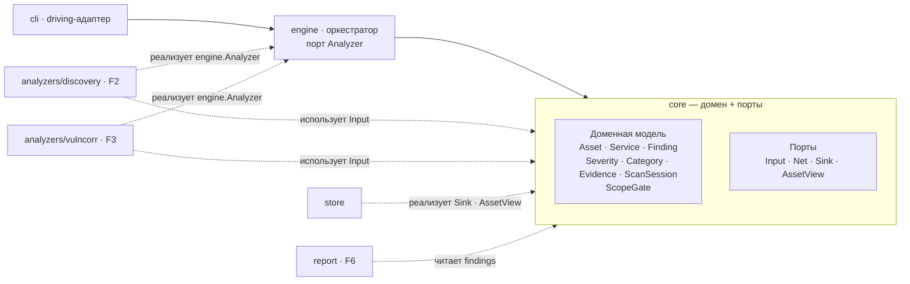

# Архитектура

**dowser** — портативный инструмент сетевого аудита. Название — от лозоходца
(dowser), который ищет скрытое под поверхностью: здесь вместо воды — уязвимости.

Гексагональная архитектура (ports & adapters) с DDD-lite доменным ядром,
раскладка package-by-feature. Все зависимости направлены внутрь, к `core`;
анализаторы — взаимозаменяемые адаптеры под один порт.

## Стиль и обоснование

Выбран **гексагон (ports & adapters) + тактический DDD-lite в ядре**.

- Ядро `core` — чистое: доменная модель и порты (интерфейсы), без I/O и без
  импортов адаптеров.
- Движок `engine` (application) крутит набор сменных анализаторов через порт
  `Analyzer` по стадиям и собирает результаты в `Sink`.
- Всё вокруг ядра — адаптеры: входной (`cli`) и выходные (`analyzers/*`,
  `store`, `report`).

Почему не чистая слоистая и не полный DDD:

- **Слоистая** (presentation → service → repository) задаёт вертикальную
  зависимость сверху вниз и плохо ложится на движок со сменными плагинами —
  задача про порты, а не про слои.
- **Стратегический DDD** (bounded contexts, aggregates, domain events,
  ubiquitous language) — оверинжиниринг для однобинарного тула. Берём только
  тактический: value objects, entities, чистое ядро без I/O.

Главный выигрыш: wireless-модуль (F1) и passive wire (F4) в v2 подключаются как
ещё два адаптера под те же порты, ядро при этом не меняется.

## Диаграмма



Сплошные стрелки — поток управления на входной стороне (`cli → engine → core`).
Пунктир — выходные адаптеры: в рантайме вызовы идут из ядра в адаптер, но
зависимость на уровне компиляции всегда указывает внутрь (адаптер зависит от
интерфейса в `core`, не наоборот). Порт `Analyzer` объявлен в `engine`, но
анализаторы его не импортируют: в Go интерфейс удовлетворяется неявно, им
достаточно `core`.

## Модули

### core

- **Ответственность:** доменная модель и порты. Чистый пакет без I/O, точка
  сборки правды о предметной области.
- **Зависит от:** только stdlib.
- **Интерфейс:** порты, которые реализуют адаптеры.

```go
// ports.go
package core

import (
    "context"
    "errors"
    "net"
)

// Stage — группа анализаторов. Стадии идут последовательно,
// анализаторы внутри стадии — конкурентно.
type Stage int

const (
    StageDiscovery   Stage = iota // собирают инвентарь
    StageCorrelation              // анализируют собранное
)

// Input — всё, что движок даёт анализатору. Новые поля добавляются
// сюда, не ломая сигнатуру Run.
type Input struct {
    Scope Scope
    Net   Net
    View  AssetView
    Sink  Sink
}

// ErrOutOfScope — Net отказал: адрес вне периметра. В core, чтобы анализатор
// мог отличить отказ гейта от закрытого порта.
var ErrOutOfScope = errors.New("target is out of scope")

// Net — единственный путь анализатора в сеть. Каждое соединение
// проходит через ScopeGate; адрес вне периметра — ошибка. Имя хоста
// резолвится внутри, проверяется каждый IP, соединение — с проверенным IP.
// DNS-запросы тоже идут через гейт: DNS-сервер вне периметра — имена
// не резолвятся (ErrOutOfScope), запрос не уходит.
type Net interface {
    Dial(ctx context.Context, network, addr string) (net.Conn, error)
}

// Sink — куда анализаторы складывают результаты.
// Гарантии, обязательные для любой реализации (in-mem, sqlite):
//   - безопасен при конкурентных вызовах: анализаторы стадии пишут параллельно;
//   - AddAsset/AddService с существующим ID заменяют запись, а не дублируют;
//   - AddFinding всегда добавляет, дедупликации нет;
//   - отменённый ctx — ошибка, запись не выполняется.
// Ошибку записи анализатор возвращает из Run: потеря результатов
// останавливает скан, следующие стадии не стартуют.
type Sink interface {
    AddAsset(ctx context.Context, a Asset) error
    AddService(ctx context.Context, s Service) error
    AddFinding(ctx context.Context, f Finding) error
}

// AssetView — чтение того, что нашли предыдущие стадии.
// Возвращает снимок в порядке добавления: изменение результата
// не меняет хранилище.
type AssetView interface {
    Assets(ctx context.Context) ([]Asset, error)
    Services(ctx context.Context) ([]Service, error)
}

// ScopeGate — гейт «не сканировать вне периметра» по CIDR периметра.
// Конкретный тип, не интерфейс: реализация одна, подменять нечего.
// Живёт в core: чистая логика без I/O, нужна и engine, и cli.
type ScopeGate struct { /* ... */ }

func NewScopeGate(s Scope) *ScopeGate
func (g *ScopeGate) InScope(target string) bool
```

### engine

- **Ответственность:** оркестратор. Грузит `Scope`, регистрирует анализаторы
  и запускает их по стадиям: стадии последовательно, анализаторы внутри
  стадии — конкурентно. Ведёт lifecycle `ScanSession`. Реализует `core.Net`
  поверх `NewScopeGate(session.Scope)` и передаёт его анализаторам в `Input`.
  Периметр у сессии один: и перебор целей, и `Net` берут его из `ScanSession`.
- **Зависит от:** `core`.
- **Интерфейс:**

```go
package engine

// Analyzer — выходной порт. Объявлен у единственного потребителя — движка.
type Analyzer interface {
    Name() string
    Stage() core.Stage
    Run(ctx context.Context, in core.Input) error
}

// Store — то, что движку нужно от хранилища (объявлен у потребителя).
type Store interface {
    core.Sink
    core.AssetView
}

type Engine struct { /* ... */ }

func New(st Store) *Engine
func (e *Engine) Register(a Analyzer)
func (e *Engine) Run(ctx context.Context, s *core.ScanSession) error
```

### analyzers/discovery (F2)

- **Ответственность:** активное обнаружение через `core.Net`: живость узлов
  TCP-connect'ом, connect-скан портов, определение прикладного протокола,
  продукта и версии. Протокол — по таблице портов (быстрый режим) или по
  содержимому ответа (`Detect`: ждать → `GET` → TLS). ARP/ICMP и SYN-скан —
  позже, когда в `Net` появятся сырые пакеты.
- **Зависит от:** `core` (реализует `engine.Analyzer`, не импортируя `engine`).
- **Интерфейс:** `engine.Analyzer`, стадия `StageDiscovery`. Настройки — через
  конструктор, не через `core`:

```go
package discovery

type Config struct {
    Ports          []int         // пусто — nmap top-100 + порты из таблицы протоколов
    Detect         bool          // false — протокол по номеру порта
    ConnectTimeout time.Duration // 1 с
    ReadTimeout    time.Duration // 2 с
    Workers        int           // 256
    MaxTargets     int           // 65536; больший периметр — ErrScopeTooLarge
}

func New(cfg Config) *Discovery
```

### analyzers/vulncorr (F3)

- **Ответственность:** пассивная корреляция — «версия сервиса → CVE» по
  offline-базе плюс конфиг-чеки cleartext-протоколов (Telnet, FTP, HTTP,
  SNMP v1/v2c).
- **Зависит от:** `core` (реализует `engine.Analyzer`, не импортируя `engine`).
- **Интерфейс:** `engine.Analyzer`, стадия `StageCorrelation`. Читает
  инвентарь через `AssetView`.

### store

- **Ответственность:** приём и хранение находок и состояния сессии. Реализует
  `core.Sink` и `core.AssetView`. Сейчас in-mem, позже file/sqlite — без
  изменений в ядре.
- **Зависит от:** `core`.
- **Интерфейс:** `core.Sink`, `core.AssetView` (+ методы чтения для `report`,
  с той же формой `(ctx) (..., error)`).

### report

- **Ответственность:** сериализация находок в JSON — единственный формат
  отчёта.
- **Зависит от:** `core`.
- **Интерфейс:**

```go
package report

func WriteJSON(w io.Writer, findings []core.Finding) error
```

### cli

- **Ответственность:** входной (driving) адаптер — разбор флагов, загрузка
  `Scope`, запуск сессии, вывод результата.
- **Зависит от:** `core`, `engine` (проводка — в `cmd/dowser`).
- **Интерфейс:** CLI-команды; наружу не экспортирует доменные типы.

### cmd/dowser

Composition root. Вся проводка зависимостей (ручной DI): собирает `store`,
`engine`, регистрирует анализаторы, отдаёт управление `cli`.

## Межмодульные модели данных

Живут в `core` и ходят между всеми модулями.

```go
package core

import (
    "net"
    "time"
)

type Severity int

const (
    SeverityInfo Severity = iota
    SeverityLow
    SeverityMedium
    SeverityHigh
    SeverityCritical
)

// Category — вид находки. Фиксированный набор, чтобы report мог группировать.
type Category string

const (
    CategoryVuln      Category = "vuln"      // известная уязвимость (CVE)
    CategoryCleartext Category = "cleartext" // протокол без шифрования
    CategoryExposure  Category = "exposure"  // лишний открытый сервис
)

// AppProto — прикладной протокол сервиса. Фиксированный набор, как Category.
// Пусто — сервис не опознан (это не значит «безопасен»).
// Продукты поверх HTTP (Elasticsearch, Kubernetes) — это
// AppProto http/https плюс Product, а не отдельные значения.
type AppProto string

const (
    AppProtoSSH, AppProtoFTP, AppProtoSMTP, AppProtoPOP3, AppProtoIMAP,
    AppProtoTelnet, AppProtoMySQL, AppProtoVNC, AppProtoRsync, AppProtoIRC,
    AppProtoHTTP, AppProtoHTTPS, AppProtoTLS, AppProtoRedis // значения — строки в нижнем регистре: "ssh", "https", …
)

// Asset — обнаруженный узел.
type Asset struct {
    ID   string
    Addr string // IP/host сейчас; задел под BSSID для wireless (v2)
}

// Service — сервис на порту узла.
type Service struct {
    ID       string
    AssetRef string // Asset.ID
    Port     int
    Proto    string   // tcp/udp
    AppProto AppProto // ssh/http/…; https — TLS с HTTP внутри, tls — TLS с неизвестным
    Banner   string   // как есть
    Product  string // разобрано из баннера, может быть пустым
    Version  string
}

// Finding — единица результата аудита.
type Finding struct {
    ID         string
    SessionID  string // ScanSession.ID
    Analyzer   string // Analyzer.Name() того, кто нашёл
    AssetRef   string // Asset.ID
    ServiceRef string // Service.ID; пусто, если находка про узел целиком
    Title      string
    Severity   Severity
    Category   Category
    References []string // CVE-ID, ссылки
    Evidence   Evidence
    Timestamp  time.Time
}

// Evidence — сырые данные, подтверждающие находку.
type Evidence struct {
    Raw  []byte
    Note string
}

// Scope — периметр скана.
type Scope struct {
    CIDRs []net.IPNet
    // BSSIDs []string — задел под wireless (v2)
}

// ScanSession — одна сессия аудита.
type ScanSession struct {
    ID        string
    Scope     Scope
    StartedAt time.Time
}
```

## Go-специфика

- **Интерфейсы объявляй на стороне потребителя.** `Analyzer` и `Store`
  живут в `engine` — их единственный потребитель. `Net`, `Sink`, `AssetView`
  живут в `core`: их используют несколько модулей, они входят в `core.Input`,
  и `core` — единственный общий пакет без зависимостей. `Stage` тоже в `core`:
  анализатор возвращает его из `Stage()` и не должен ради этого импортировать
  `engine`. Нет нескольких реализаций — нет интерфейса (`ScopeGate`).
  Accept interfaces, return structs. Если адаптеру нужна своя зависимость —
  её интерфейс объявляется внутри адаптера, а не глобально.
- **DI вручную, без фреймворка.** Весь граф зависимостей собирается в
  `cmd/dowser/main.go`. wire/fx для такого размера избыточны.
- **В сеть — только через `Input.Net`.** Анализатор не вызывает `net.Dial`
  и не создаёт `http.Client` с транспортом по умолчанию; HTTP-клиенту
  подставляется `Transport.DialContext = in.Net.Dial`, тогда и редиректы
  проходят через гейт. Держится на соглашении и ревью.
- **Зависимости только внутрь.** `core` не импортирует `analyzers`, `store`,
  `cli`, `engine`. Потянуло наружу — абстракция протекла, это сигнал.
- **Один статический бинарь.** Важно для портативной тулзы; `gopacket` закрывает
  и wired-захват, и radiotap/802.11 для будущего wireless-модуля.

## Ключевые решения

- **Гексагон вместо слоистой:** движок со сменными плагинами — это про порты, а
  не про вертикальные слои; отвергли presentation → service → repository.
- **DDD-lite вместо полного DDD:** взяли value objects / entities / чистое ядро;
  отвергли bounded contexts, aggregates, domain events как оверинжиниринг для
  однобинарного тула.
- **Go как язык:** единый статический бинарь, `gopacket`, удобная конкуренция;
  Python/scapy оставили для экспериментов, C/eBPF отвергли в v1 как оверкилл.
- **Стадии анализаторов вместо графа зависимостей (T2):** анализатор
  объявляет `Stage()`, движок выполняет стадии по очереди. Отвергли
  `Requires/Provides` с топосортом (оверкилл для двух анализаторов v1) и ручную
  проводку в `cmd/dowser` (скрытая зависимость мимо портов). Цена: новая
  ступень цепочки = новая константа в `core`. Путь миграции, если стадий
  станет мало, — необязательный интерфейс `DataDeps` рядом со `Stage`.
- **Service — отдельная сущность (T1):** vulncorr работает с сервисами, а у
  узла их много. Отвергли срез внутри `Asset` (перезапись узла на каждый порт)
  и хранение в `Evidence` (структурированные данные в сырых байтах).
- **Периметр проверяется в `Net`, а не в анализаторах:** движок даёт
  анализатору сетевой доступ, который сам спрашивает `ScopeGate` перед каждым
  соединением, — забыть проверку нельзя. Отвергли самопроверку в каждом
  анализаторе и передачу гейта для добровольного вызова. Ограничение: сырые
  пакеты (ARP, SYN через `gopacket`) идут мимо `Dial` — когда они появятся,
  `Net` получит проверяющий метод отправки. v1 начинается с connect-скана.
- **`ctx` и `error` в `Sink`/`AssetView`:** store скоро переезжает на sqlite,
  а запись и чтение с диска могут упасть или зависнуть. Ошибка возвращается
  из каждого вызова и прерывает стадию сразу. Отвергли накопление ошибки в store
  с проверкой между стадиями: анализаторы продолжали бы сканировать впустую.
- **`AppProto` в `Service`:** порт — договорённость, а не гарантия; без поля
  проверка открытого текста в vulncorr работает только на стандартных портах.
  Discovery заполняет его всегда: в быстром режиме — по таблице портов, в
  режиме `--detect` — по содержимому ответа сервиса. Потребитель читает одно
  поле и не знает, каким способом оно получено.
- **DNS через гейт:** резолвер `Net` (`net.Resolver{PreferGo: true}`)
  отправляет запросы через тот же `Net`. Иначе запрос имени уходил бы на
  DNS-сервер вне периметра и раскрывал бы внутренние имена. Отвергли
  «только IP» (придётся переделывать, когда понадобятся имена) и «оставить
  как есть». Ограничение: если DNS-сервер — локальная заглушка
  (`127.0.0.53` systemd-resolved) и она в периметре, дальше она сама ходит
  наружу, этого гейт не видит.
- **Ручной DI:** прозрачная сборка графа в composition root; отвергли
  DI-фреймворки.
- **Вертикальный срез v1:** сквозной путь `scope → discovery → correlation →
  report` на обычном интерфейсе; wireless (F1) отложен в v2 на готовое ядро.

## Открытые вопросы

Нет.
